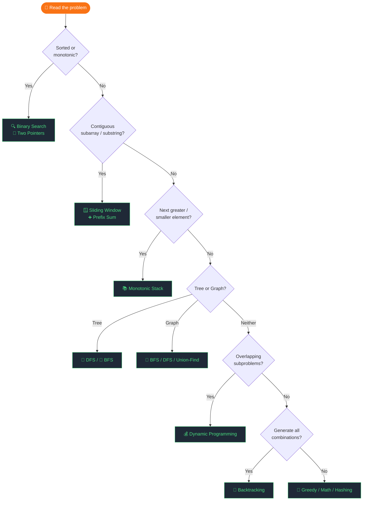

<div align="center">



<a href="https://github.com/Kushagra524/LeetCode-DSA">
  
</a>

<a href="https://github.com/Kushagra524/LeetCode-DSA">
  
</a>

<br/>

<p>
  <a href="https://leetcode.com/u/kushagra_20/"></a>
  <a href="https://github.com/Kushagra524"></a>
  <a href="https://kaggle.com/kushagrasrivastava21"></a>
  <a href="https://linkedin.com/in/kushagra-srivastava-19a170332"></a>
</p>

<p>
  
  
  
  
  
  
  
  
</p>

<b>A structured daily-grind journal. Not a solution dump.</b><br/>
<sub>Every notebook teaches a <i>pattern</i>: intuition first, brute force second, optimal last, complexity always.</sub>

<br/><br/>

<a href="#-live-leetcode-stats"></a>
<a href="#-solved-problems"></a>
<a href="#-roadmap"></a>
<a href="#-how-to-spot-the-pattern"></a>
<a href="#-pattern-cheatsheets"></a>
<a href="#-complexity-reference"></a>
<a href="#-getting-started"></a>

</div>


## 📊 Live LeetCode Stats

> Pulled live from my LeetCode profile each time this page loads. No manual edits, no fake numbers.

<div align="center">

<a href="https://leetcode.com/u/kushagra_20/">
  
</a>

<br/>


</div>


## 🧠 What Is This Repo?

Most DSA repos are folders of code you can't learn from. This one is a **learning log**: each notebook is written so that someone who has never seen the problem can follow *why* the solution works, not just *what* it is.

Every notebook follows the same five-step format:

| Step | What you get |
|:---:|---|
| 📌 | **Problem Statement**: restated in plain words, with edge cases |
| 💡 | **Intuition & Thought Process**: how to *arrive* at the idea, not just the idea |
| 🐢 | **Brute Force**: the obvious approach and exactly why it's too slow |
| 🚀 | **Optimized**: the pattern that fixes it, with a dry run |
| 📊 | **Complexity Breakdown**: time and space, justified |

Written in **plain, readable Python**, Kaggle-notebook style. Zero over-engineering.


## 📂 Solved Problems

Click a problem name to open it on LeetCode, or a notebook to open the write-up.

| # | Problem | Difficulty | Pattern | Notebook |
|:---:|---|:---:|---|---|
| 9 | [Palindrome Number](https://leetcode.com/problems/palindrome-number/) | 🟢 Easy | Math · Digit reversal | [`Leetcode_09`](./Leetcode_09.ipynb) |
| 50 | [Pow(x, n)](https://leetcode.com/problems/powx-n/) | 🟡 Medium | Recursion · Fast exponentiation | [`Leetcode_50`](./Leetcode_50.ipynb) |
| 231 | [Power of Two](https://leetcode.com/problems/power-of-two/) | 🟢 Easy | Math · Bit tricks | [`Leetcode_231`](./Leetcode_231.ipynb) |
| 326 | [Power of Three](https://leetcode.com/problems/power-of-three/) | 🟢 Easy | Math · Recursion | [`Leetcode_326`](./Leetcode_326.ipynb) |
| 342 | [Power of Four](https://leetcode.com/problems/power-of-four/) | 🟢 Easy | Math · Bit tricks | [`Leetcode_342`](./Leetcode_342.ipynb) |
| 509 | [Fibonacci Number](https://leetcode.com/problems/fibonacci-number/) | 🟢 Easy | Recursion → DP | [`Leetcode_509`](./Leetcode_509.ipynb) |
| 1137 | [N-th Tribonacci Number](https://leetcode.com/problems/n-th-tribonacci-number/) | 🟢 Easy | Recursion → DP | [`LeetCode_1137`](./LeetCode_1137.ipynb) |
| 1281 | [Subtract the Product and Sum of Digits](https://leetcode.com/problems/subtract-the-product-and-sum-of-digits-of-an-integer/) | 🟢 Easy | Math · Digit extraction | [`Leetcode_1281`](./Leetcode_1281.ipynb) |
| 1431 | [Kids With the Greatest Number of Candies](https://leetcode.com/problems/kids-with-the-greatest-number-of-candies/) | 🟢 Easy | Array · Single pass | [`Leetcode_1431`](./Leetcode_1431.ipynb) |
| 2520 | [Count the Digits That Divide a Number](https://leetcode.com/problems/count-the-digits-that-divide-a-number/) | 🟢 Easy | Math · Digit extraction | [`Leetcode_2520`](./Leetcode_2520.ipynb) |

**Foundations:** [`Recursion_Practice`](./Recursion_Practice.ipynb) · [`Time_&_Space_Complexity`](./Time_&_Space_Complexity.ipynb)


## 🗺️ Roadmap

| # | Topic | Core Patterns | Status |
|:---:|---|---|:---:|
| 01 | Arrays & Hashing | HashMap, frequency count, prefix sum | ✅ |
| 02 | Two Pointers | Shrink window, fast-slow, 3Sum | ✅ |
| 03 | Sliding Window | Fixed & variable window | ✅ |
| 04 | Stack / Monotonic | LIFO, next greater/smaller | ✅ |
| 05 | Binary Search | Halving, rotated arrays | ✅ |
| 06 | Linked Lists | Floyd's cycle, reversal, merge | ✅ |
| 07 | Trees | DFS, BFS, recursion, LCA | ✅ |
| 08 | Graphs | Union-Find, BFS/DFS traversal | ✅ |
| 09 | Dynamic Programming | Memoization, tabulation | 🔄 |
| 10 | Backtracking | Permutations, subsets | 📋 |
| 11 | Heaps & Priority Queue | Top-K, merge K sorted | 📋 |
| 12 | Tries | Prefix tree, word search | 📋 |

> ✅ Complete &nbsp;·&nbsp; 🔄 In Progress &nbsp;·&nbsp; 📋 Upcoming


## 🧭 How to Spot the Pattern

Stuck on a new problem? Walk this decision tree before writing a single line.



**Keyword → pattern, at a glance**

| If the problem says... | Reach for |
|---|---|
| "sorted array", "find pair", "palindrome" | 🔁 Two Pointers |
| "longest / shortest substring with…", "subarray of size k" | 🪟 Sliding Window |
| "next greater", "daily temperatures", "valid parentheses" | 📚 Monotonic Stack |
| "minimum value that satisfies…", "rotated array" | 🔍 Binary Search |
| "number of islands", "connected components", "shortest path" | 🔗 BFS / DFS / Union-Find |
| "count the ways", "min cost", "can you reach" | 💰 Dynamic Programming |
| "all subsets / permutations / combinations" | 🧩 Backtracking |
| "top K", "kth largest", "merge K sorted" | ⛰️ Heap |


## 💡 Pattern Cheatsheets

Copy-paste-ready templates. Click to expand.

<details>
<summary><b>🔁 Two Pointers</b> &nbsp;—&nbsp; <code>O(n) time · O(1) space</code></summary>

```python
left, right = 0, len(arr) - 1
while left < right:
    s = arr[left] + arr[right]
    if s == target:   return [left, right]
    elif s < target:  left += 1
    else:             right -= 1
```
**When to use:** sorted array, pair sum, palindrome check, 3Sum, container with most water.
</details>

<details>
<summary><b>🪟 Sliding Window</b> &nbsp;—&nbsp; <code>O(n) time · O(k) space</code></summary>

```python
left, best = 0, 0
window = {}
for right, ch in enumerate(s):
    window[ch] = window.get(ch, 0) + 1
    while len(window) > k:        # shrink condition
        window[s[left]] -= 1
        if window[s[left]] == 0:
            del window[s[left]]
        left += 1
    best = max(best, right - left + 1)
return best
```
**When to use:** max/min subarray, longest substring with a constraint, duplicates within a window.
</details>

<details>
<summary><b>📚 Monotonic Stack</b> &nbsp;—&nbsp; <code>O(n) time · O(n) space</code></summary>

```python
stack, result = [], [-1] * len(arr)
for i, num in enumerate(arr):
    while stack and arr[stack[-1]] < num:
        result[stack.pop()] = num
    stack.append(i)
return result
```
**When to use:** next greater element, daily temperatures, histogram max area, bracket matching.
</details>

<details>
<summary><b>🔍 Binary Search</b> &nbsp;—&nbsp; <code>O(log n) time · O(1) space</code></summary>

```python
lo, hi = 0, len(arr) - 1
while lo <= hi:
    mid = lo + (hi - lo) // 2
    if arr[mid] == target:  return mid
    elif arr[mid] < target: lo = mid + 1
    else:                   hi = mid - 1
return -1
```
**When to use:** sorted array, rotated sorted array, search on answer (min/max valid value).
</details>

<details>
<summary><b>🌲 DFS on Tree</b> &nbsp;—&nbsp; <code>O(n) time · O(h) space</code></summary>

```python
def dfs(node):
    if not node:
        return 0
    left  = dfs(node.left)
    right = dfs(node.right)
    return 1 + max(left, right)   # max depth example
```
**When to use:** height/depth, path sum, LCA, subtree problems, serialization.
</details>

<details>
<summary><b>🔗 BFS Level-Order</b> &nbsp;—&nbsp; <code>O(n) time · O(n) space</code></summary>

```python
from collections import deque
q, result = deque([root]), []
while q:
    level = []
    for _ in range(len(q)):
        node = q.popleft()
        level.append(node.val)
        if node.left:  q.append(node.left)
        if node.right: q.append(node.right)
    result.append(level)
return result
```
**When to use:** shortest path, level-by-level traversal, multi-source BFS, word ladder.
</details>

<details>
<summary><b>🧩 Union-Find (DSU)</b> &nbsp;—&nbsp; <code>O(α·n) ≈ O(1) per op</code></summary>

```python
parent = list(range(n))
rank   = [0] * n

def find(x):
    if parent[x] != x:
        parent[x] = find(parent[x])   # path compression
    return parent[x]

def union(x, y):
    px, py = find(x), find(y)
    if px == py: return False
    if rank[px] < rank[py]: px, py = py, px
    parent[py] = px
    if rank[px] == rank[py]: rank[px] += 1
    return True
```
**When to use:** number of islands, redundant connection, accounts merge, connected components.
</details>

<details>
<summary><b>💰 Dynamic Programming</b> &nbsp;—&nbsp; <code>bottom-up templates</code></summary>

```python
# Climbing stairs
dp = [0] * (n + 1)
dp[1], dp[2] = 1, 2
for i in range(3, n + 1):
    dp[i] = dp[i-1] + dp[i-2]
return dp[n]

# 0/1 Knapsack
dp = [[0] * (W + 1) for _ in range(n + 1)]
for i in range(1, n + 1):
    for w in range(W + 1):
        dp[i][w] = dp[i-1][w]
        if weights[i-1] <= w:
            dp[i][w] = max(dp[i][w],
                           dp[i-1][w - weights[i-1]] + values[i-1])
return dp[n][W]
```
**When to use:** overlapping subproblems, optimal substructure, count ways, min/max cost.
</details>

<details>
<summary><b>⚡ Fast Exponentiation</b> &nbsp;—&nbsp; <code>O(log n) time</code></summary>

```python
def power(x, n):
    if n < 0:
        x, n = 1 / x, -n
    result = 1
    while n:
        if n & 1:
            result *= x
        x *= x
        n >>= 1
    return result
```
**When to use:** Pow(x, n), modular exponentiation, matrix power for Fibonacci in O(log n).
</details>


## 🏆 Complexity Reference

**Algorithms**

| Algorithm | Time | Space | Notes |
|---|:---:|:---:|---|
| Two Pointers | O(n) | O(1) | Requires sorted input |
| Sliding Window | O(n) | O(k) | k = window size |
| Binary Search | O(log n) | O(1) | Sorted / monotonic |
| BFS / DFS | O(V + E) | O(V) | Graph & tree traversal |
| Merge Sort | O(n log n) | O(n) | Stable, divide & conquer |
| Quick Sort | O(n log n) avg | O(log n) | In-place, unstable |
| Heap Push/Pop | O(log n) | O(n) | Priority queue ops |
| Union-Find | O(α·n) | O(n) | Near-constant per op |
| Dijkstra | O((V+E) log V) | O(V) | Non-negative weights |
| Topological Sort | O(V + E) | O(V) | DAG only |

**Data structures**

| Structure | Access | Search | Insert | Delete |
|---|:---:|:---:|:---:|:---:|
| Array | O(1) | O(n) | O(n) | O(n) |
| Hash Map | n/a | O(1) avg | O(1) avg | O(1) avg |
| Linked List | O(n) | O(n) | O(1)* | O(1)* |
| Stack / Queue | O(n) | O(n) | O(1) | O(1) |
| Binary Heap | O(1) top | O(n) | O(log n) | O(log n) |
| BST (balanced) | O(log n) | O(log n) | O(log n) | O(log n) |

<sub>* once the node is already located</sub>

**How fast is fast enough?** Rough guide for a 1-second limit:

| Input size `n` | Target complexity |
|:---:|:---:|
| ≤ 20 | O(2ⁿ), O(n!) |
| ≤ 500 | O(n³) |
| ≤ 5,000 | O(n²) |
| ≤ 10⁵ – 10⁶ | O(n log n), O(n) |
| ≥ 10⁹ | O(log n), O(1) |


## 🚀 Getting Started

```bash
# 1. Clone
git clone https://github.com/Kushagra524/LeetCode-DSA.git
cd LeetCode-DSA

# 2. Install Jupyter
pip install notebook

# 3. Open any notebook
jupyter notebook Leetcode_09.ipynb
```

Or open directly in **VS Code** with the Jupyter extension. Zero extra setup.


## 📝 Notebook Template

Want to follow the same format for your own practice? Start every problem like this:

```markdown
# 🔢 <number>. <Problem Title>      [Easy | Medium | Hard]

## 📌 Problem Statement
<restate in your own words + 2 edge cases>

## 💡 Intuition & Thought Process
<what did you notice? what pattern does this smell like?>

## 🐢 Brute Force
<code> + why it's too slow

## 🚀 Optimized
<code> + dry run on a small example

## 📊 Complexity
Time: O(?)   Space: O(?)   <one-line justification each>
```


## 🤝 Contributing

Found a cleaner approach, a typo, or a missing edge case? Contributions are welcome.

1. Fork the repo and create a branch: `git checkout -b feat/leetcode-<number>`
2. Follow the [notebook template](#-notebook-template) above
3. Open a PR with the problem number and pattern in the title


## ⭐ Star History

<div align="center">

<a href="https://star-history.com/#Kushagra524/LeetCode-DSA&Date">
  
</a>

</div>


## 📬 Connect

<div align="center">

| Platform | Link |
|:---:|---|
| 🐙 GitHub | [github.com/Kushagra524](https://github.com/Kushagra524) |
| 📊 Kaggle | [kaggle.com/kushagrasrivastava21](https://kaggle.com/kushagrasrivastava21) |
| 💼 LinkedIn | [linkedin.com/in/kushagra-srivastava-19a170332](https://linkedin.com/in/kushagra-srivastava-19a170332) |
| 🟠 LeetCode | [leetcode.com/u/kushagra_20](https://leetcode.com/u/kushagra_20/) |

</div>

<br/>

<div align="center">

```
╔══════════════════════════════════════════════════════════╗
║    "First, solve the problem. Then, write the code."     ║
║                      — John Johnson                      ║
╚══════════════════════════════════════════════════════════╝
```

**Found it useful? Drop a ⭐. It keeps the grind going.**


</div>
